  

  
  
  
  
  

## 👋 About me

I'm a **B.Tech CSE (AI & ML)** student at KIET (CGPA 8.4) who likes building **AI that works for India**.

- 🧭 Building **Bharat-Router** — an LLM router that understands Hinglish and code-mixed queries
- 🚁 Ex-**Autonomous Systems Intern @ Teific Technology** — drone computer vision for road hazards
- ☁️ **AWS Certified** Solutions Architect + Cloud Practitioner
- 💻 Practising **Data Structures & Algorithms in C++** every week
- 🎯 Looking for **SDE / ML internships**

## 🔭 Now building — Bharat-Router

> Most LLM routers are trained on English. I measure where they break on Hinglish, and build one that doesn't.

| What I found | English | Hinglish |
|---|:---:|:---:|
| RouteLLM BERT router quality (AUC, pilot n=40) | **0.55** | **0.33** — worse than a coin toss |
| Queries a 3B model can safely answer (qwen2.5:3b) | **76%** | **28%** |
| Answers that never stop (hit the 2,000-token limit) | **0%** | **15%** |
| Input tokens for the same question (GPT-4o tokenizer) | 1.00× | **1.26×** |

**Stack:** Python · RouteLLM · BERT · Ollama · Groq · Kaggle T4 GPUs · LLM-as-a-judge · tiktoken  
📊 Full findings → [rohansharma52.github.io/#work](https://rohansharma52.github.io/#work)

## 💼 Experience

**Autonomous Systems Intern — Teific Technology Pvt. Ltd.** · *Jun – Sep 2026 · paid, 4 months* · [certificate ↗](https://rohansharma52.github.io/Teific_Internship_Certificate.pdf)

- Trained a **YOLO** object detector on **~10,000 aerial drone images** to spot **potholes, traffic congestion and waterlogged roads** — **~92% detection accuracy**
- Worked on sensor integration, embedded and control systems for the company's drone platform

**Web Developer Intern — STBG Academy** · *Jun – Aug 2025*

## 🚀 Featured projects

<table>
<tr>
<td width="50%" valign="top">

### 🧭 [Bharat-Router](https://rohansharma52.github.io/#work)
Cost-aware LLM router for Hinglish. 200-prompt parallel benchmark across 7 domains + LLM-as-a-judge labels.

`LLMs` `RouteLLM` `Ollama` `Kaggle`
</td>
<td width="50%" valign="top">

### 🔍 TruthLens AI — *team lead*
Multimodal fake-news & deepfake detection with RAG: text claims, out-of-context images, deepfake video (English + Hindi). Research paper in progress.

`RAG` `Deepfakes` `Ollama`
</td>
</tr>
<tr>
<td width="50%" valign="top">

### 🛡️ [KAWACH](https://github.com/Rohansharma52/KAWACH)
Women's safety app — SOS alerts, live location, emergency SMS, voice-triggered SOS and AI risk alerts.

`Live location` `Voice SOS`
</td>
<td width="50%" valign="top">

### 🌿 [KrishiMitra](https://github.com/Rohansharma52/KrishiMitra)
ML crop recommendation from soil and environmental data — full pipeline from preprocessing to prediction.

`Python` `ML pipeline`
</td>
</tr>
</table>

## 🧰 Tech stack

**Languages**  

**AI / ML**  

**Cloud & backend**  

## 🏆 Certifications

- **AWS Certified Solutions Architect** — [verify ↗](https://cp.certmetrics.com/amazon/en/public/verify/credential/fd661743e85a4bbaac3bacf95fa0b76b)
- **AWS Certified Cloud Practitioner (CLF-C02)** — [verify ↗](https://cp.certmetrics.com/amazon/en/public/verify/credential/3b0a0f6e329a4d309a003b76e0b8c902)
- **Deep Learning for Developers** — Infosys Springboard (35 hours)
- Introduction to Machine Learning · Introduction to Data Science

## 📊 GitHub activity

  
  

  

## 🌐 Elsewhere

Keep learning. Keep building. Keep shipping. 🚀

